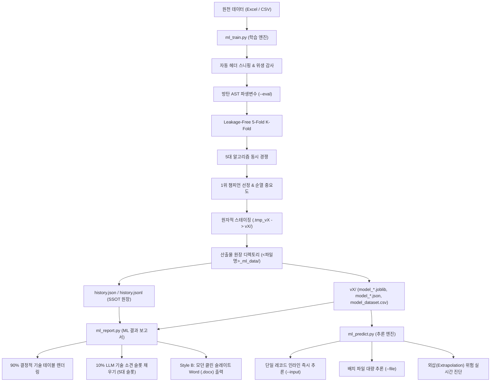
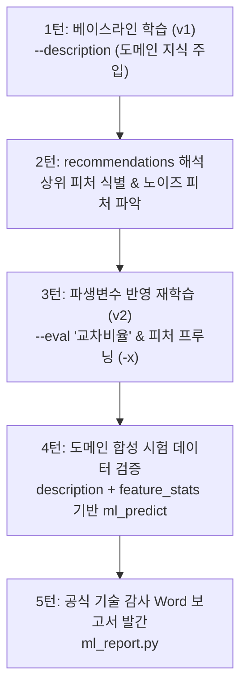

# ml-kit 2.1: 경량 AI 에이전트를 위한 자율 회귀·분류 머신러닝 툴킷 (Autonomous Regression / Classification ML Toolkit)

> **26B~30B 경량화 LLM(Glimmer-30B, OpenCode 등)에 최적화된 1-Turn 완결형 머신러닝 학습, 추론 및 기술 감사 엔진**  
> 복잡한 다단계 판단이나 인간의 개입 없이, 단 1회의 선언적 CLI 명령으로 데이터 자동 정제, 방탄 파생변수 생성, 5대 회귀/분류 모델 경쟁 학습, 단일 진실 공급원(SSOT) 원장 누적, 초고속 서빙 추론, 그리고 Word(.docx) ML 결과 보고서 생성을 100% 자율 완결합니다.

---

## 1. 핵심 아키텍처 원칙 (Core Architectural Principles)

1. **완전 독립 자립형 (100% Standalone & Zero-Office COM)**:
   - 외부 프레임워크나 무거운 분산 엔진, MS Office COM(Component Object Model) 의존성을 일체 배제합니다.
   - 순수 `Python + Scikit-Learn + Pandas + NumPy + Joblib + python-docx`만으로 작동하여 가상 데스크톱, Linux/Windows 서버, CI/CD 컨테이너 환경에서 0.1초대의 초고속 백그라운드 무인 실행을 보장합니다.

2. **26B~30B 경량화 LLM 최적화 (1-Turn Declarative Execution & Zero-Token Bloat)**:
   - 추론 능력이 제한된 온프레미스 경량 LLM이 복잡한 루프를 돌지 않도록, 단 1회의 CLI 명령 호출로 모든 워크플로우를 완결합니다.
   - 표준 1줄 구조화 JSON(`{"status": "ok", "agent_directive": "VERIFIED: ...", ...}`)을 반환하여 에이전트의 불필요한 재시도 및 토큰 낭비를 원천 차단합니다.

3. **단일 진실 공급원 (Single Source of Truth, SSOT)**:
   - 모든 실험 이력은 `history.jsonl`(스트리밍 라인)과 `history.json`(포맷 배열)으로 이중 동기화 보존됩니다.
   - 추가적인 데이터 조회 없이 이 원장 단 하나만으로 차수별 계보(Lineage Evolution), 2차원 변수 상관행렬, 5대 모델 벤치마크, 순열 중요도, 외삽 경계선, 데이터 품질 감사를 100% 완전 재현합니다.

4. **원자적 트랜잭션 보장 (Atomic Staging & Self-Healing Garbage Collection)**:
   - 학습 도중 예기치 못한 중단(`Ctrl+C`, 프로세스 킬, 메모리 부족) 발생 시 미완성 잔여물이 운영 환경을 오염시키지 않도록 임시 디렉토리(`.tmp_vX/`)에서 모든 작업을 수행합니다.
   - 모든 검증과 아티팩트 저장이 100% 완료된 순간에만 원자적 이름 변경(`vX/`)을 수행하고, **그 다음에** 원장에 기록합니다 (커밋이 실패하면 원장에 없는 버전이 남지 않음). 프로세스 기동 시 도구가 만든 `.tmp_*` 잔여물만 자가 청소(GC)합니다.
   - **사용자 확인 없이 지우거나 덮어쓰지 않습니다 (2.3.0)**: 불완전한 `vN` 폴더는 지우지 않고 `[WARN]`과 `incomplete_versions`로 알린 뒤 그 번호를 건너뜁니다. 이미 있는 `--version`은 `--overwrite` 없이는 거부합니다.
     예측 결과·보고서 파일이 이미 있으면 시각을 붙인 새 이름으로 저장하고 JSON `recovered`에 적습니다 (덮어쓰기는 `--overwrite`).

5. **터미널 및 인코딩 무결성 (Clean Terminal Principle & CP949/UTF-8 Dual Guard)**:
   - Windows 콘솔의 폰트 폭 계산 오차, 줄바꿈 꼬임, 로그 오염, 인코딩 에러(`UnicodeEncodeError`)를 유발하는 유니코드 이모지(아이콘, 원문자 등)의 사용을 엄격히 금지하고 표준 텍스트 태그(`[INFO]`, `[PROGRESS]`, `[WARN]`, `[ERROR]`, `[STATUS]`)만을 사용합니다.
   - 한국어 Windows 환경에서 Excel 더블클릭 시 한글이 깨지지 않도록 모든 데이터 CSV는 `CP949`를 우선 적용하며, 특수문자 예외 발생 시 `utf-8-sig`로 자동 폴백합니다.

---

## 2. 시스템 디렉토리 구조 및 역할

### 1) 코드베이스 디렉토리 구조
```text
CLI/ml-kit/                 # 실행에 필요한 파일만 (사내 PC C:\CLI\ml-kit)
├── SKILL.md                # 경량 LLM 에이전트용 스킬 (짧은 명령 템플릿 + 결과 처리 규칙)
│
├── [1단계: 학습 엔진]
│   └── ml_train.py         # 자동 헤더 스니핑, 방탄 AST 파생변수, 5대 회귀/분류 경쟁, 리더보드, SSOT 패키징
│
├── [2단계: 추론 엔진 + 공통 런타임]
│   └── ml_predict.py       # 단독 배포 가능. 파생 수식 재현, 외삽/저확신 경고, 회귀·분류 자동 분기
│                           # PART C: 데이터 로딩, 수치 변환, 수식 엔진, JSON 규약, Windows 파일 처리 (train/report가 import)
│
├── [3단계: ML 결과 보고서]
│   └── ml_report.py        # 버전 폴더 1개 -> Word 문서 1개 (회귀·분류, 차트 포함, 소견 자동 작성)
│
├── [표 보간·반대 찾기]
│   └── ml_map.py           # 모델 없이 표 선형 보간 (격자/흩어진 기록 자동 판단), 반대 찾기 (2.6.0)
│
└── [성능예측표]
    └── ml_export.py        # 입력 최적화 -> 엑셀 계산기 (수식만, 잠금) (2.9.0)

data/logs/errors.txt        # 실패한 실행의 오류 로그 (자동 생성, git 제외, 8장 4) 참고)

CLI-dev/ml-kit/             # 개발·실기 테스트용 (사내 PC C:\CLI-dev\ml-kit, C:\CLI와 나란히)
├── README.md               # [본 문서] 툴킷 종합 안내서, 완전 CLI 레퍼런스
├── CHANGELOG.md            # 변경 이력 + 남은 할 일 (2.0.0부터 관리)
├── requirements.txt        # 런타임 의존성
├── tests/                  # CLI 계약 + 회귀 테스트 (도구는 ../../CLI/ml-kit에서 불러옴)
└── tools/run_win_tests.py  # Windows 실기 테스트 (실제 Excel/Word, 파일 잠금, cmd/PowerShell, 배포 폴더)
                            #   --dir은 없는 경로나 빈 폴더 (러너가 만든 폴더만 다시 비움)
                            #   결과: 테스트 폴더 report_*.txt(요약) + tools/test_logs/testlog_<라벨>_<시각>.txt(AI 판독용 상세 로그)
```

### 1-B) OpenCode 스킬 설치

도구는 `C:\CLI\ml-kit`에 둡니다. `SKILL.md`의 명령 경로가 이 위치 기준으로 적혀 있습니다 (사내 PC 배치 안내: `docs/opencode/README.md`).
OpenCode는 `skills/<name>/SKILL.md` 를 찾으며 **폴더 이름이 스킬 이름(`ml-kit`)과 같아야** 합니다.

1. 스킬 폴더 `C:\Users\<사용자>\.config\opencode\skills\ml-kit\`에 `C:\CLI\ml-kit\SKILL.md`만 복사합니다 (도구 갱신 때 같이 덮어씀).
2. 도구를 다른 위치에 두면 `SKILL.md` 안의 `C:\CLI\ml-kit`을 그 경로로 모두 바꿉니다.
3. 권한을 제한하는 경우 `opencode.json` 에 `"permission": {"skill": {"ml-kit": "allow"}}` 를 추가합니다.
4. OpenCode에서 에이전트가 `skill({ name: "ml-kit" })` 로 스킬을 불러오는지 확인합니다.

### 2) 런타임 산출물 원장 계층 구조 (`<데이터파일명>_ml_data/`)
학습 엔진 실행 시 입력 데이터셋 파일과 동일한 디렉토리에 `<파일명>_ml_data/` 폴더가 자동 생성되며 모든 산출물이 원자적으로 격리 관리됩니다:

```text
<데이터파일명>_ml_data/
├── history.jsonl              # [SSOT 스트리밍] 회차별 실험 메타데이터 누적 원장 (JSON Lines)
├── history.json               # [SSOT 표준배열] 가독성 및 LLM 일괄 조회를 위한 동기화 원장 (JSON Array)
├── ML결과보고서_<데이터>_vX.docx # [ML 결과 보고서] ml_report.py 기본 저장 위치
├── 성능예측표_<데이터>_vX.xlsx   # [성능예측표] 회귀 보고서와 함께 생성 (ml_export.py, 2.9.2)
├── .train.lock                # [동시 실행 잠금] 학습 중에만 OS 잠금 (비정상 종료 시 자동 해제)
├── .tmp_vX/                   # [임시 트랜잭션] 원자적 스테이징 폴더 (작업 성공 시 vX로 치환, 실패 시 자동 GC)
└── vX/                        # [버전 체크포인트 디렉토리] (v1, v2, v3, ...)
    ├── model_<타겟>.joblib     # 1위 챔피언 파이프라인 (전처리[수치 대치+스케일, 범주 원-핫] + 모델 일체형)
    ├── model_<타겟>.json       # 타겟별 추론 메타데이터 (feature_schema, 지표, 외삽 경계, 예측 범위, 판정 기준, 파생 수식)
    ├── leaderboard.json       # 5대 알고리즘 교차검증 대조표 (튜닝된 params 포함)
    ├── correlation.csv        # 전체 상관행렬 (원장에는 피처 30개 이하로 축약 저장)
    ├── oof_<타겟>.csv          # 챔피언의 교차검증 예측값 (실측·예측·잔차 또는 클래스별 확률, 보고서 그림 원본, 2.2.0)
    ├── next_features_*.txt    # next_commands용 피처 목록 (피처 15개 초과 시)
    ├── excluded_rows.csv      # 학습에서 뺀 행 (원본 행, 구분, 이유, 실제값, 예측값, 2.5.0 / CSV는 2.9.5)
    ├── export/                # 성능예측표용으로 다시 학습한 모델과 후보 표 (2.9.0)
    └── model_dataset.csv      # 학습 당시 헤더 정제, 결측치 대치, 파생변수가 완료된 스냅샷 (CP949/UTF-8 호환)
```

---

## 3. 전체 엔드투엔드 파이프라인 흐름 (System Pipeline Architecture)



---

## 4. 학습 엔진 (`ml_train.py`) 상세 가이드

단 1회의 명령으로 [데이터 로드 -> 비표준 헤더 스니핑 -> 결측치 대치 -> 방탄 파생변수 -> 5대 모델 5-Fold 경쟁 -> 리더보드 -> 챔피언 가중치 패키징 -> SSOT 원장 갱신]을 완전 무인으로 완결합니다.

### 0) 피처 유형 자동 판별 (2.1.0)
`-x`에 넣은 컬럼마다 도구가 유형을 정합니다. 판별 결과는 결과 JSON `feature_types`에 나옵니다.

| 유형 | 판별 기준 | 모델 입력 |
|---|---|---|
| 수치 | 값의 90% 이상이 숫자 (`1,234` 허용) | 중앙값 대치 + 표준화 |
| 날짜 | Excel 날짜 셀, 또는 90% 이상이 `YYYY-MM-DD[ HH:MM]` (`/` `.` 구분 허용) | `<컬럼>_year/month/day/dayofweek/hour` (값이 변하는 것만) |
| 범주 | 그 외 문자 컬럼 | 결측은 `__missing__`, 원-핫 인코딩 (처음 보는 값은 무시 + 예측 시 경고) |

- 종류가 200개를 넘거나, 50개를 넘으면서 행의 절반 이상이 서로 다른 문자 컬럼은 ID로 보고 `STOP_RETRY`.
- `--dtypes "설비코드:str,측정일:datetime,값:float"`로 유형을 강제할 수 있습니다.
- 날짜 분해는 파이프라인 밖(`ml_predict.py` PART C)에서 하므로 모델 파일에 사용자 코드가 저장되지 않고, `ml_predict.py` 단독 배포가 유지됩니다.

### 1) 5대 다중 회귀 모델 경쟁 풀 (Champion Selection)
수학적 성격이 완전히 상이한 5대 핵심 알고리즘을 누수 방지 파이프라인(`Pipeline(ColumnTransformer[수치: SimpleImputer(median) -> StandardScaler(), 범주: OneHotEncoder] -> Regressor)`)에 탑재하여 동시 5-Fold 교차검증을 수행하고, 검증 결정계수($Val\ R^2$) 최상위 1개 모델을 타겟별 공식 챔피언으로 선정합니다:

1. **HistGradientBoostingRegressor**: 비선형 복합 관계, 대용량 데이터, 결측치 및 이상치에 강건한 고성능 히스토그램 기반 GBDT.
2. **RandomForestRegressor**: 다수의 결정 트리를 배깅(Bagging)하여 과적합을 방지하고 분산을 최소화하는 전통적 앙상블.
3. **ExtraTreesRegressor**: 분할 지점을 극단적으로 무작위화하여 노이즈가 많은 연속형 공정 데이터에서 최상의 일반화 성능을 발휘하는 앙상블.
4. **Ridge** (`RidgeCV`): L2 정규화 선형 베이스라인. 정규화 강도 alpha를 1e-3~1e3 범위에서 자동 선택.
5. **ElasticNet** (`ElasticNetCV`): L1+L2 결합 희소 선형 모델. alpha와 l1_ratio(0.1/0.5/0.9)를 내부 3-Fold로 자동 선택.

선택된 값은 `leaderboard.json`의 `params`에 기록됩니다. 대용량 데이터(1만 행 초과)에서는 RF/ET 트리마다 1만 행 표본을 사용하고, 순열 중요도는 최대 5,000행 표본으로 계산합니다.

- **예측 범위 (2.1.0)**: 챔피언 모델의 교차검증 잔차(OOF residual) 5%·95% 분위수를 저장하고, 예측 시 `pred_lo_<타겟>`, `pred_hi_<타겟>`(90% 범위)를 함께 출력합니다. 폭이 일정한 근사 범위입니다.

### 1-B) 분류 모드 (`--task classification`)
작업 유형은 사용자가 `--task`로 지정합니다 (기본값 `regression`, 자동 판별 없음). 분류 모드는 같은 누수 방지 파이프라인(`SimpleImputer(median) -> StandardScaler() -> Classifier`)으로 **Stratified K-Fold** 교차검증을 수행하고, **OOF Macro-F1** 최상위 모델을 챔피언으로 선정합니다.

1. **HistGradientBoostingClassifier** 2. **RandomForestClassifier** 3. **ExtraTreesClassifier** 4. **LogisticRegression** (`LogisticRegressionCV`, C 자동 선택) 5. **KNeighborsClassifier** (5만 행 초과 시 제외)

- **이진 분류 판정 기준 (`--positive-class <라벨>`)**: 양성 클래스(예: 불량)를 지정하면 챔피언의 교차검증 확률로 양성 F1이 최대가 되는 기준 확률(0.05~0.95)을 찾아 `decision_threshold`로 저장하고, 예측 시 그 기준으로 라벨을 정합니다. 지정하지 않으면 기본(최대 확률) 판정입니다.

- **지표**: Macro-F1(선정 기준), Accuracy, Balanced Accuracy, ROC-AUC(이진/다중 ovr), 혼동행렬, 클래스별 Precision·Recall·F1 (`vX/leaderboard.json`)
- **라벨 정규화**: `1`, `1.0`, `"1"`은 같은 클래스 `"1"`로, 공백·`-`·`N/A`는 결측으로 처리하며 결측 라벨 행은 학습에서 제외
- **불균형 대응**: 최소 클래스 비율이 20% 미만이면 `class_weight='balanced'` 자동 적용 (`[WARN]` 출력, 처방에 기록)
- **검증**: 클래스 2개 미만, 샘플 1개짜리 클래스, 클래스 50개 초과는 `STOP_RETRY`. fold 수는 최소 클래스 샘플 수에 맞춰 자동 축소
- **이력 비교**: `delta_score`, `is_best`는 같은 task + 같은 타겟 조합의 이전 기록끼리만 비교 (같은 원장에 다른 타겟·회귀/분류 기록 공존 가능)
- **보고서**: `ml_report.py`가 분류 버전도 같은 구성으로 작성 (혼동행렬, 클래스별 성능 표)

```bash
python ml_train.py -f "공정.xlsx" -x "반응온도,촉매비율,수분함량" -y "품질등급" --task classification --tag "분류_베이스라인"
```

### 2) 방탄 AST 파생변수 엔진 (`--eval`)
파이썬의 위험한 `eval()` 함수를 일체 배제하고, `ast.parse`를 통한 화이트리스트 수학 연산자 구문 분석기(AST Evaluator)를 내장하였습니다:
- **지원 연산자**: 덧셈(`+`), 뺄셈(`-`), 곱셈(`*`), 나눗셈(`/`), 거듭제곱(`**`), 괄호 연산
- **안전 내장 수학 함수**: `log(x)`, `log1p(x)`, `exp(x)`, `sqrt(x)`, `abs(x)`
- **동적 연쇄 정의 지원**: 세미콜론(`;`)으로 구분하여 앞서 정의한 파생변수를 즉시 다음 수식의 인자로 참조 가능:
  `--eval "온도압력비 = 반응온도 / (압축압력 + 1e-6); 로그비 = log1p(온도압력비)"`
- **컬럼명 표기**: 전체 이름(`반응온도(°C)`) 또는 단위를 뺀 이름(`반응온도`) 모두 허용합니다. 단위를 뺀 이름이 하나의 컬럼에만 해당할 때 자동 매칭되며, 원장/메타데이터에는 항상 전체 이름으로 저장되어 추론 시 그대로 재현됩니다.
- **타겟 누수 차단**: 수식에 타겟(-y) 컬럼이 포함되면 `[DATA LEAKAGE DETECTED]` 오류로 즉시 중단합니다.

### 3) 비표준 복합 헤더 자동 감지 (Auto-Header Sniffing)
현업 엑셀 데이터의 상단 빈 행(None), 보고서 타이틀, 결재란을 지능적으로 건너뜁니다:
- `--header-row`를 생략하더라도 데이터가 시작되는 유효 컬럼 헤더 행을 자동 탐색합니다.
- `--unit-row`를 지정하면 단위 행을 컬럼명과 안전 결합(`반응온도` + `°C` -> `반응온도(°C)`)합니다.

### 4) 대량 피처 파일 투입 지원 (`-x`, `-y`)
피처의 수가 수십~수백 개에 달할 경우 CLI 명령어 길이 제한을 극복하기 위해 파일 입력을 지원합니다:
- **지원 포맷**:
  - `.txt`: 한 줄에 하나씩 컬럼명 작성 (또는 쉼표 구분). `#` 주석 지원.
  - `.json`: `["피처1", "피처2", ...]` 형태의 JSON 리스트.
  - `.csv`: 컬럼 헤더 또는 첫 번째 행의 변수 목록 자동 추출.

### 5) LLM 도메인 컨텍스트 고정 및 자동 상속 메커니즘 (`--description` vs `--tag`)
경량화 LLM(26B~30B)이 수십 회차의 모델 튜닝(`v1` -> `v2` -> `vN`)을 반복할 때, "이 데이터셋이 무엇이며 왜 학습하는가"에 대한 상위 도메인 지식을 유실하지 않도록 **프로젝트 목적 설명(`--description`)**과 **회차별 실험 메모(`--tag`)**를 명확히 분리하였습니다:
- **`--description` (`--desc`)**:
  - 데이터셋의 비즈니스 도메인 및 모델링 궁극적 목적을 기술 (예: `"화학공정 복합 반응기 실시간 생산효율 예측 및 운전조건 최적화"`).
  - **버전 간 자동 상속 (Inheritance)**: `v1` 생성 시 한 번만 지정해 두면, 이후 `v2`, `v3` 학습 시 `--description`을 생략하더라도 직전 버전의 설명이 `history.json`과 메타데이터에 100% 자동 계승 및 영구 고정됩니다. (물론 새로운 목적이 생기면 명시적으로 덮어쓸 수도 있습니다.)
  - 추론 요약 JSON, 터미널 원장 요약표, Word ML 결과 보고서 제목에 일관되게 박제되어 LLM이 컨텍스트를 즉시 인지합니다.
- **`--tag`**:
  - 해당 회차만의 고유한 엔지니어링 가설 및 파라미터 변경 사항을 기록 (예: `"베이스라인"`, `"파생변수2종_추가"`, `"상관계수0.9이상_피처제거"`).
  - 매 회차마다 독립적으로 기록되며 상속되지 않습니다.

### 6) CLI 명령어 인자 레퍼런스
| 옵션 | 축약 | 필수 | 설명 |
|---|:---:|:---:|---|
| `--file` | `-f` | **필수** | 입력 데이터 파일 경로 (`.xlsx`, `.csv`) |
| `--features` | `-x` | **필수** | 독립변수 목록 (쉼표 구분 문자열 또는 파일 경로: `.txt`, `.json`, `.csv`). 단위 생략 이름 허용 |
| `--targets` | `-y` | **필수** | 종속변수 목록 (쉼표 구분 문자열 또는 파일 경로: `.txt`, `.json`, `.csv`). 단위 생략 이름 허용 |
| `--description` | `--desc` | 선택 | **데이터셋 및 도메인 모델링 목적 설명** (인라인 문자열 또는 파일 경로 `.txt`, `.md`. SSOT 영구 고정 및 차기 버전 자동 상속) |
| `--tag` | - | 선택 | 이번 실험 회차의 세부 엔지니어링 메모 태그 (예: `결측치대치_실험`, `파생변수2종_추가`) |
| `--eval` | - | 선택 | 방탄 AST 파생변수 생성 수식 (세미콜론 구분) |
| `--header-row` | - | 선택 | 컬럼명 헤더 행 번호 (1-based, 미지정 시 상단 빈 행 자동 건너뜀) |
| `--unit-row` | - | 선택 | 단위 행 번호 (지정 시 컬럼명에 안전 결합: `반응온도(°C)`) |
| `--data-row` | - | 선택 | 실제 데이터 시작 행 번호 (비표준 표 레이아웃 처리용) |
| `--dtypes` | - | 선택 | 데이터 타입 수동 오버라이드 (예: `일시:datetime,코드:str`) |
| `--version` | `-v` | 선택 | 버전 폴더 수동 지정 (미지정 시 `v1`, `v2`, ... 자동 채번). 이미 있는 버전이면 `STOP_RETRY` + `[추천] --version v<다음>` |
| `--overwrite` | - | 선택 | `--version` 폴더가 이미 있을 때 교체 (사용자 확인 후에만). 새 버전이 원장에 기록될 때까지 기존 폴더를 `.bak_vX`로 보관했다가 실패하면 되돌림 |
| `--encoding` | - | 선택 | 산출물 CSV 저장 인코딩 (기본값: Windows Excel 호환 `cp949`) |
| `--task` | - | 선택 | 학습 유형 `regression`(기본값) / `classification`. `--best`와 함께 쓰면 그 유형의 최고 버전만 |
| `--positive-class` | - | 선택 | 이진 분류 양성 클래스. 지정 시 판정 기준 확률 자동 조정 |
| `--seed` | - | 선택 | 교차검증 난수 시드 (기본값: 42) |
| `--history` | - | 선택 | 누적 실험 원장 조회 (요약 표는 stderr, 버전별 요약 JSON은 stdout) |
| `--best` | - | 선택 | 최고 버전 만들기 (2.4.0, 아래 8) 참고). `-f`만 필요. `-x`, `-y`, `--eval`, `--dtypes`, `--version`, `--positive-class`는 무시 |

### 7) 실행 예시

#### [예시 A] 도메인 설명 고정 및 단일 타겟 기본 학습 (헤더/단위 자동 결합)
```bash
python ml_train.py \
  --file "sample_v2.xlsx" \
  --header-row 3 --unit-row 4 --data-row 5 \
  -x "반응온도(°C),소비전력(kW),유입유속(m/s),압축압력(bar),촉매비율(wt%),수분함량(%)" \
  -y "생산효율(%)" \
  --description "화학공정 복합 반응기 실시간 생산효율 예측 및 운전조건 최적화" \
  --tag "베이스라인_학습"
```

#### [예시 B] 도메인 설명 자동 상속(생략) 및 방탄 AST 파생변수 적용
```bash
# --description을 생략해도 v1의 프로젝트 목적 설명이 v2로 100% 자동 계승 및 고정됨
python ml_train.py \
  --file "sample_v2.xlsx" \
  -x "features_list.txt" \
  -y "생산효율(%)" \
  --eval "에너지집중도 = 소비전력 / (반응온도 + 1e-6); 촉매반응비 = 촉매비율 / (수분함량 + 1e-6)" \
  --tag "파생변수2종_추가실험"
```

#### [예시 C] 다중 타겟 (Multi-Target 4종) 동시 경쟁 학습
```bash
python ml_train.py \
  --file "sample_v2.xlsx" \
  -x "features.txt" \
  -y "압축압력(bar),촉매비율(wt%),인장강도(MPa),생산효율(%)" \
  --tag "4대타겟_독립경쟁"
```

### 8) 최고 버전 (`--best`, 2.4.0)

실제 사용에서 경량 LLM이 타겟을 하나씩, 조건을 바꿔 가며 학습해 v1~v7이 타겟별로 흩어졌습니다. 사용자는 항상 모든 타겟이 들어간
보고서 1개를 원하고, LLM이 타겟·버전을 고르기를 원하지 않습니다. `--best`는 이 정리를 도구가 합니다.

```bat
python ml_train.py -f sample.xlsx --best
python ml_train.py -f sample.xlsx --best --task classification
```

1. 원장(`history.jsonl`)에서 타겟마다 검증 점수(회귀 `val_r2`, 분류 `val_f1_macro`)가 가장 높은 기록을 고릅니다. 같은 점수면 나중 기록.
   버전 폴더가 없거나 불완전한(`leaderboard.json`, `model_dataset.csv`, `model_<타겟>.json` 없음) 기록은 제외합니다.
2. 그 기록의 학습 조건(피처, `--eval` 수식, `--dtypes`, 양성 클래스)으로 **현재 데이터 파일**에서 모든 타겟을 다시 학습해
   새 버전 1개(`vN`, 태그 `best`)에 담습니다. 모델 종류는 평소처럼 5개 모델 경쟁으로 다시 고릅니다.
   타겟마다 피처가 달라도 됩니다: `model_<타겟>.json`의 `features_required`, `feature_schema`, `derived_evals`가 타겟별이므로
   `ml_predict.py -m vN`은 모든 타겟의 피처를 합친 입력으로 그대로 예측합니다.
3. 작업 유형마다 버전 1개입니다. 이력에 회귀와 분류가 모두 있으면 최고 버전도 2개가 됩니다 (`best_versions`).
4. 헤더/단위/데이터 행은 주지 않으면 그 유형의 마지막 기록 값을 씁니다.
5. 이력이 없으면 `STOP_RETRY`(먼저 학습). 점수가 내려가도 경고하지 않고, 타겟별 원래 점수와 이번 점수를 함께 보고합니다.

결과 JSON에는 평소 학습 키(첫 번째 버전 기준)에 더해 다음이 들어갑니다.

| 키 | 의미 |
|---|---|
| `made_best` | 이번 실행에서 다시 학습했는지 (`--best`는 항상 `true`) |
| `best_version`, `best_version_dir` | 최고 버전 (유형이 2개면 회귀 쪽) |
| `best_versions` | `[{task, version, version_dir, targets, mean_val_score, made}]` |
| `best_targets` | `{타겟: {task, source_version, source_score, new_score}}` 학습 조건 출처 버전, 그때 점수, 이번 점수 |

원장 기록에는 `best: true`, `best_source: {타겟: {"version", "score"[, "selected_version"]}}`, `target_recipes`(타겟별 조건)가 추가됩니다.
이전 최고 버전의 조건이 다시 뽑히면 `best_source`는 원래 버전을 가리킵니다 (`selected_version`에 실제로 고른 최고 버전).

---

### 9) 학습 제외 행: `제외` 열과 자동 이상치 (2.5.0)
데이터 파일은 고치지 않습니다. 옵션도 없습니다. 타겟마다 아래 규칙으로 학습에서 뺄 행을 정합니다.

| `제외` 열 값 (열 이름 고정, 단위 무시) | 처리 |
|---|---|
| 빈칸, `0`, `FALSE` (또는 `제외` 열 없음) | 자동 이상치 검사 대상 (0/1, TRUE/FALSE 표시도 그대로 쓸 수 있음) |
| `포함` | 자동 이상치로 빼지 않음 |
| 그 밖의 글자 (예: `센서오류`) | 직접 표시. 학습에서 빼고, 글자를 이유로 기록 |

- **자동 이상치**: 회귀는 타겟과 수치 피처, 분류는 수치 피처(파생변수 제외)에서 로버스트 z 점수 `|0.6745 (x - 중앙값) / MAD| > 3.5`인 값이 있는 행. MAD가 0이면 IQR 3배 울타리.
  후보가 검사 대상의 10%를 넘거나(넓게 퍼진 분포로 보고) 남는 행이 10개 미만이 되면 자동 제외하지 않고 `auto_note`로 알립니다. 분류에서는 어떤 클래스도 2행 미만으로 줄이지 않습니다.
- `제외` 열은 피처로 쓰지 않습니다(`-x`에 있으면 `[WARN]`과 함께 뺌). 타겟으로 지정하면 `STOP_RETRY`.
- **점수 용어** (보고서, preview 공통)

  | 용어 | 계산 | 쓰임 |
  |---|---|---|
  | 학습 R² / 학습 Macro-F1 | 각 겹에서 학습한 행에 다시 맞춘 점수의 평균 (`train_r2`, `train_f1_macro`). 학습 제외 행은 학습하지 않으므로 항상 미포함 | 학습-검증 간극(과적합) 확인 |
  | 검증 R² / 검증 Macro-F1 | 모델이 배우지 않은 행을 맞힌 점수. 학습 제외 행이 있을 때만 아래 둘로 나눠 적음 | |
  | - (제외 행 미포함) | 학습 제외 행을 뺀 데이터의 5겹 교차검증 (`val_r2`, `val_f1_macro`, `mean_val_score`) | 챔피언 선정, 판정, 목표 0.90 |
  | - (제외 행 포함) | 위 교차검증 예측 + 학습 제외 행을 최종 모델로 예측한 값 (`all_rows_score`) | 이상치가 섞인 실제 데이터에서의 성능 참고 |

- 학습 범위(`feature_stats`, 예측 시 외삽 경고 기준)와 타겟 통계는 학습에 쓴 행으로만 계산합니다.
- 산출물: `vX/excluded_rows.csv` (열: 타겟, 원본 행, 구분(직접 표시/자동 이상치), 이유, 실제값, 예측값). 원본 행은 엑셀 행 번호(CSV는 빈 줄을 뺀 줄 번호).
- 결과 JSON: `exclusions` = `{타겟: {column, manual, auto, forced_include, auto_note, all_rows_score}}`, `excluded_rows_file`. 원장에는 `exclusions`, `model_<타겟>.json`에는 `excluded`, `leaderboard.json` 챔피언에는 `all_rows_score`.
  제외한 행이 없고 `포함` 표시도 없으면 이 키들은 생기지 않습니다.
- 보고서: 요약 표에 "검증 R² (제외 행 포함)" 열, 데이터 장에 제외 규칙과 타겟별 행 수, 타겟 장에 한 줄, 실측 대비 예측 그림에 학습 제외 행을 주황색 X로 표시.

## 5. 추론 엔진 (`ml_predict.py`) 상세 가이드

학습 단계에서 패키징된 아티팩트를 로드하여, 단일 레코드 인라인 추론(Zero-File) 또는 배치 파일 대량 예측을 0.1초 만에 수행합니다.

### 0) 단독 배포 (Standalone Deployment)
`ml_predict.py`는 다른 ml-kit 파일을 import하지 않습니다. 예측 PC에는 아래 2가지만 복사하면 됩니다:
```text
배포폴더/
├── ml_predict.py
└── v3/                 # 학습 결과 버전 폴더 (model_*.joblib, model_*.json)
```
```bat
python ml_predict.py -m v3 -i "반응온도=240,소비전력=65"
```
필요 라이브러리: numpy, pandas, scikit-learn, joblib (+ xlsx 입출력 시 openpyxl). 학습 PC와 같은 scikit-learn 버전을 권장하며, 다르면 `[WARN]`이 출력됩니다.

### 1-A) 실측 비교값 (map check, 2.7.0)
회귀 예측마다 같은 조건을 학습 데이터에서 찾은 **실측 비교값**을 함께 냅니다. 옵션은 없습니다.
- 데이터: 버전 폴더의 `model_dataset.csv` (버전 폴더와 함께 배포되므로 원본 데이터 불필요). 2.7.0부터 이 파일에 `원본행`(엑셀 행 번호)과
  `학습제외_<타겟>`(1 = 이상치·'제외'로 학습에서 뺀 행)이 있어, 근거에 엑셀 행 번호를 쓰고 학습 제외 행은 비교에 쓰지 않습니다.
  이전 버전은 두 열 없이 계산하고 `map_check_notes`에 알림 (근거 행 = 사본 줄 번호).
- 계산: 숫자 입력(파생변수·날짜 제외) 3개 이하 -> `ml_map.py`와 같은 표 보간 (격자 / 둘러싼 실측 / 추세선 외삽),
  4개 이상 -> 가까운 실측 5행의 거리 가중평균 (입력을 0~1로 맞춤). 범주 입력은 같은 범주 행만 (학습에 없는 범주면 전체 행 + 알림).
- 출력: 한 건(5건 이하) `predictions_summary.<타겟>.map_check` = `[{value, diff(예측-비교값), method, basis(원본 행, 비율), extrapolated, outside_interval}]`,
  `map_check_keys`, `map_check_outside_interval`. 파일 예측은 `map_<타겟>`, `map_diff_<타겟>`, `map_방식_<타겟>` 열.
- 경고 `map_check_warning`/`map_check_warnings`: 비교값이 90% 예측 범위 밖일 때. 단 외삽된 비교값과, 가중평균 방식에서 가장 가까운 실측이
  0.1(0~1 거리)보다 먼 경우는 경고하지 않음 (입력이 많으면 가까운 실측도 멀어 비교값이 거침).
- 분류 타겟은 계산하지 않습니다. 입력이 20,000행을 넘거나 사본이 없으면 생략하고 `map_check_notes`로 알립니다. 비교값 계산 실패는 예측을 막지 않습니다.

### 1-B) 모델 반대 찾기 (`--find`, `--vary`, 2.8.0)
```bat
python ml_predict.py -m v3 --find "생산효율=105" --vary 반응온도 -i "압축압력=3,촉매비율=2.5"
```
- 다른 입력을 고정하고 `--vary` 입력을 학습 범위 안에서 2,000단계로 바꿔 한 번에 예측, 목표값을 지나는 지점을 모두 찾습니다.
  범위의 3%보다 가까운 답은 하나로 묶어 구간(`from`~`to`)으로 줍니다 (트리 모델은 예측이 계단 모양이라 가짜 교차가 생김). 학습 범위 밖은 찾지 않습니다.
- `operating_windows`: 목표가 90% 예측 오차 안에 드는 입력 구간 (예측값이 `[목표 - residual_upper, 목표 - residual_lower]` 안). 답이 없는 아주 짧은 구간은 버림.
- 고정하지 않은 숫자 입력은 학습 중앙값(`filled_defaults`, 경고), 글자·날짜 입력은 `STOP_RETRY` + `[후보]`. 분류 타겟은 `STOP_RETRY`.
- `measured`: 숫자 입력 3개 이하면 같은 조건의 학습 데이터 표 보간으로 찾은 답 (실측이 둘러싼 영역 안). 모델 답과 범위의 5% 넘게 다르면 경고.
  4개 이상이면 생략하고 `nearest_rows`(목표값·고정 조건에 가까운 실측 5행)만.
- 확인: 답 구간 주변을 다시 예측해 목표값을 지나는지 확인하면 `VERIFIED`. 0건이면 `reachable`(학습 범위에서 가능한 예측 최소~최대).

### 1) 핵심 안전장치 및 기능
- **회귀/분류 자동 분기**: 모델 메타데이터의 `task`로 분기합니다 (`task`가 없는 1.x 모델은 회귀). 분류 모델은 `pred_<타겟>`(라벨), `proba_<타겟>_<클래스>`(클래스별 확률), `conf_<타겟>`(최대 확률) 컬럼을 만들고, 확신도 0.6 미만 예측이 있으면 `low_confidence_warning: true`를 반환합니다.
- **입력 점검 경고 (2.1.0)**: 빈 값/숫자가 아닌 값이 대치되면 `missing_input_warning`과 컬럼별 `missing_input_counts`, 학습 때 없던 범주가 오면 `unseen_category_warning`, 학습 기간 밖 날짜는 `drift_warnings`에 추가됩니다.
- **회귀 예측 범위**: `pred_lo_<타겟>`, `pred_hi_<타겟>` 컬럼, 인라인 JSON `intervals`(90%).
- **이전 버전 모델**: 2.9.1 이전에 학습한 모델은 쓰지 않습니다 (`STOP_RETRY`, 같은 데이터로 다시 학습). 베타 기간에는 이전 버전 호환을 두지 않습니다.
- **폴더 대상 일괄 추론 (`--model <버전폴더>`)**: 특정 버전 디렉토리(`v1/`, `v2/`)를 지정하면 폴더 내에 저장된 모든 타겟 모델을 자동 스캔하여 다중 타겟 예측 컬럼(`pred_<타겟1>`, `pred_<타겟2>`)을 자동 일괄 생성합니다.
- **파생변수 수식 자동 재현 (Replay Evaluator)**: 학습 당시 적용되었던 `--eval` 수식이 메타데이터에 보존되어 있으므로, 새로운 추론 데이터가 입력되면 동일한 파생변수를 자동으로 사전 계산하여 모델에 투입합니다.
- **외삽 및 데이터 드리프트 실시간 진단 (Extrapolation Guard)**: 입력 피처 값이 학습 시점의 동적 경계선(`[min, max]`)을 벗어날 경우, 터미널 로그에 `[WARN] Extrapolation detected`를 출력하고 예측 결과 데이터셋에 경고 플래그(`drift_warning`)를 부착합니다.

### 2) CLI 명령어 인자 레퍼런스
| 옵션 | 축약 | 필수 | 설명 |
|---|:---:|:---:|---|
| `--model` | `-m` | **필수** | 버전 폴더 경로(`sample_ml_data/v1/`) 또는 개별 `.joblib` 경로 |
| `--meta` | - | 선택 | 개별 `.joblib` 지정 시 메타데이터 경로 (생략 시 동일 폴더 자동 탐색) |
| `--targets` | `-y` | 선택 | 추론할 특정 타겟 목록 (폴더 모드에서 생략 시 폴더 내 전체 타겟 자동 추론) |
| `--file` | `-f` | 선택* | 배치 추론 대상 데이터 파일 경로 (`.xlsx`, `.csv`) |
| `--input` | `-i` | 선택* | 단일 즉시 추론용 입력 (`k1=v1,k2=v2` 키-값 쌍, JSON 문자열, 또는 `.json` 파일 경로). Windows 셸에서는 따옴표 이스케이프가 필요 없는 키-값 쌍 또는 `.json` 파일을 권장. 단위 생략 키 허용 |
| `--out` | `-o` | 선택 | 예측 결과 CSV 저장 경로 (생략 시 `원본_pred_타임스탬프.csv` 자동 생성). 파일이 이미 있으면 `<이름>_<시각>.csv`로 저장하고 `recovered`에 기록 |
| `--overwrite` | - | 선택 | `--out` 파일이 이미 있으면 덮어쓰기 (사용자 확인 후에만) |
| `--header-row` | - | 선택 | 컬럼명 헤더 행 번호 (배치 파일 추론 시) |
| `--unit-row` | - | 선택 | 단위 행 번호 (배치 파일 추론 시) |
| `--data-row` | - | 선택 | 데이터 시작 행 번호 (배치 파일 추론 시) |
| `--encoding` | - | 선택 | 결과 CSV 저장 인코딩 (기본값: `cp949`) |

*\* `--file`과 `--input` 중 최소 1개는 반드시 지정해야 합니다.*

### 3) 실행 예시

#### [예시 A] 버전 폴더 대상 배치 엑셀 파일 추론 (다중 타겟 일괄 예측)
```bash
python ml_predict.py \
  --model "sample_v2_ml_data/v5" \
  --file "new_process_batch.xlsx" \
  --header-row 3 --unit-row 4 --data-row 5 \
  --out "batch_predictions.csv"
```

#### [예시 B] 단일 레코드 즉시 인라인 추론 (Zero-File Fast API 모드)
```bash
python ml_predict.py \
  --model "sample_v2_ml_data/v5" \
  --input "반응온도(°C)=240.5,소비전력(kW)=65.2,유입유속(m/s)=7.8,압축압력(bar)=3.2,촉매비율(wt%)=0.8,수분함량(%)=22.1"
```
**반환 JSON**:
```json
{
  "status": "ok",
  "predictions_summary": {
    "생산효율(%)": {
      "model": "ExtraTrees",
      "predictions": [58.5032]
    }
  },
  "agent_directive": "VERIFIED: Inline prediction completed."
}
```

---

## 6. ML 결과 보고서 (`ml_report.py`) 상세 가이드

선택한 버전 폴더의 **모든 타겟을 Word 문서 1개**에 담습니다 (회귀·분류 모두, 2.2.0). python-docx와 matplotlib만 사용하며 Office 프로그램이 없어도 생성됩니다.

### 1) 사용법

| 옵션 | 설명 |
|---|---|
| `--file`, `-f` | 데이터 파일 (2.4.0, **권장**). 이력의 모든 타겟을 담은 최고 버전(`ml_train.py --best`와 같음)으로 작업 유형마다 보고서 1개 |
| `--task` | `-f`와 함께: 이 작업 유형의 보고서만 |
| `--header-row`, `--unit-row`, `--data-row` | `-f`와 함께: 최고 버전을 새로 학습할 때 표 구조 (생략 시 이력 값) |
| `--model`, `-m` | 버전 폴더 (학습 결과의 `version_dir`). 그 버전 그대로 |
| `--data-dir`, `-d` | 데이터 폴더. `-v`가 없으면 가장 최근 학습과 같은 task·타겟 조합 중 최고 점수 버전 |
| `--version`, `-v` | `-d`와 함께 쓸 버전 (`v2` 또는 `2`) |
| `--target`, `-t` | 문서에 넣을 타겟만 지정 (쉼표 구분, 생략 또는 `all` = 전체) |
| `--title` | 성능예측표 계산기 맨 위 제목 (30자 안팎, 생략 시 학습 때 데이터 설명에서, 2.9.2) |
| `--slots` | 소견 덮어쓰기 JSON (파일 또는 문자열) |
| `--out`, `-o` | 저장 경로 (생략 시 데이터 폴더의 `ML결과보고서_<데이터>_<버전>.docx`). 이미 있으면 `<이름>_<시각>.docx`로 저장하고 `recovered`에 기록 |
| `--overwrite` | 같은 이름의 보고서가 있으면 덮어쓰기 (사용자 확인 후에만) |

```bat
python ml_report.py -f sample.xlsx
python ml_report.py -m sample_ml_data\v3
python ml_report.py -d sample_ml_data --slots slots.json
```

`-f` 동작 (2.4.0): 작업 유형마다 마지막 최고 버전(`best: true` 기록)을 확인해 아래가 모두 맞으면 그대로 쓰고(`made_best: false`),
아니면 먼저 최고 버전을 새로 만듭니다(`made_best: true`, 같은 프로세스 안에서 학습하므로 몇 분 걸릴 수 있음).
- 그 최고 버전 뒤에 같은 유형의 다른 학습 기록이 없다.
- 버전 폴더가 온전하다.
- 데이터 파일 내용이 그때와 같다 (원장 `data_fingerprint`의 SHA-256, 없으면 크기와 수정 시각).

최고 버전 보고서에는 제목 아래 최고 버전 안내 한 줄과, 타겟마다 "학습 조건 출처: vK (당시 점수 x.xxxx), 이번 점수 y.yyyy"가 들어갑니다.
입력 피처 구성과 예측 필수 입력은 모든 타겟의 합집합입니다.
2.2.0 이전에 학습한 버전(`oof_<타겟>.csv` 없음)은 다시 학습해야 보고서를 만들 수 있습니다 (`STOP_RETRY`로 안내).

### 2) 문서 구성

2.4.1부터 핵심만 담은 간결한 문서입니다 (목차·쪽 나눔 없음, 보통 3~4쪽).

| 구분 | 내용 | 그림·표 |
|---|---|---|
| 제목 | 제목, 목적(`--desc`), 데이터·버전·작업·작성일 한 줄 | - |
| 1. 요약 | 핵심 수치 카드, 타겟별 판정, 요약 소견(권고 포함) | 타겟별 요약 표 |
| 2. 데이터와 피처 | 불러온/사용한 행, 결측 대치, 피처 유형·학습 범위 (파생변수는 "파생"으로 강조) | 피처 표 |
| 2.1. 파생변수 | `--eval`로 만든 변수의 계산식을 원래 컬럼 이름과 ×, ÷, ² 기호로 표시, 사용 타겟별 기여도·순위 | 계산식 표 |
| 2.2. 상관관계 | 중요도 상위 12개 피처와 타겟의 상관, 타겟별 상관 높은 입력, 다중공선성 쌍(\|r\| >= 0.85) | 히트맵 |
| 3. 분석 방법 | 후보 모델, 교차검증, 선정 기준, 누수 방지를 한 단락으로 | - |
| 4. 타겟별 결과 | 판정·출처 한 줄, 지표 카드, 성능과 기여도 그림 1장, 상위 3개 모델, 소견 1개 | 회귀: 실측 대비 예측 + 기여도 / 분류: 혼동행렬 + 기여도, 클래스별 성능 표 |

2.4.0까지 있던 목차, 5. 버전 이력, 6. 운영 가이드, 부록 B(산출물·실행 환경)는 없앴고, 부록 A 상관관계는 2.2로 옮겼습니다.

**판정**: 검증 점수(회귀 검증 R², 분류 검증 Macro-F1) 0.90 이상 적합, 0.70 이상 조건부, 그 미만 부적합. 적합이라도 학습-검증 간극이 0.15를 넘으면 조건부. 종합 판정은 가장 낮은 타겟 기준입니다.

**디자인**: A4 세로, 맑은 고딕, 슬레이트 회색 + 남색 강조 1색(흑백 인쇄 가능), 고정 너비 표, 표·그림 번호, 머리글(문서명·데이터·버전), 바닥글(쪽 번호). 같은 이름 파일이 Word에 열려 있으면 시각을 붙인 새 파일로 저장합니다.

### 3) 소견 (`--slots`)
모든 문장은 수치로부터 자동 작성되며, 원하는 항목만 바꿀 수 있습니다.
```json
{"summary": "...", "data": "...", "performance": "...", "features": "...", "lineage": "...",
 "correlation": "...", "operation": "...",
 "targets": {"생산효율(%)": {"performance": "...", "features": "..."}}}
```
`lineage`/`operation`은 해당 장이 없어져 요약 소견 끝에 붙습니다 (2.4.1). `performance`/`features`는 타겟별 값이 없으면 문서 수준 값을 모든 타겟에 씁니다.

---

## 6-B. 표 보간·반대 찾기 (`ml_map.py`, 2.6.0)

모델 없이 표(엑셀/CSV)를 직접 읽어 선형 보간합니다. 예측 결과를 표 값과 맞춰 보는 검증 용도입니다. 데이터 파일은 고치지 않습니다.

```bat
python ml_map.py -f 공정.xlsx -i "반응온도=232.5" [-y "생산효율,소비전력"]          :: 사이값 (-y 생략 시 나머지 숫자 열 전부)
python ml_map.py -f 공정.xlsx -i "반응온도=232.5,소비전력=60,라인=A"               :: 기준 2개 + 글자 열(그 값인 행만)
python ml_map.py -f 공정.xlsx --find "생산효율=50" --vary 반응온도 [-i "소비전력=60"] :: 반대 찾기
python ml_map.py -f 공정.xlsx --points 조회.xlsx [--save 결과.xlsx]                  :: 여러 점 -> 결과 엑셀
```
공통 옵션: `--header-row`, `--unit-row`, `--data-row` (ml_train과 같음). 열 이름은 단위를 빼도 됩니다.

| 데이터 모양 (숫자 기준 1~3개) | 판단 | 보간 | 범위 밖 |
|---|---|---|---|
| 격자 | 기준 값 조합이 빠짐없음 (기준 1개면 간격이 일정) | 기준마다 위아래 값의 비율 (전통 맵핑, 꼭짓점 2/4/8개) | 끝 구간 직선 연장 |
| 흩어진 기록, 기준 1개 | 그 밖 | 위아래 실측 2점 | 전체 추세선(최소제곱 직선) |
| 흩어진 기록, 기준 2~3개 | 그 밖 | 둘러싼 실측 3~4점(Delaunay, 기준을 0~1로 맞춤)의 비율 | 전체 추세선 |

- 흩어진 기록에서 끝 두 점 외삽은 쓰지 않습니다 (잡음 때문에 기울기가 터짐, 예: -1998).
- 같은 기준 값 행: 값이 같으면 하나로, 다르면 평균하고 경고(이 경우 격자로 보지 않음). 기준 4개 이상은 보간 없이 가까운 실측만.
- '제외' 열에 글자가 있는 행(포함 제외)은 쓰지 않습니다. 자동 이상치 제외는 하지 않습니다 (맵은 표 값이 기준).
- 반대 찾기: 고정 조건에서 `--vary` 열을 따라 보간 곡선을 만들고 목표값을 지나는 지점을 모두 찾습니다. 격자와 흩어진 기록(기준 1개)은
  범위 밖도 찾고(외삽 경고), 흩어진 기록(기준 2~3개)은 실측이 둘러싼 영역 안에서 2,000단계로 훑습니다. 찾은 답은 보간식에 다시 넣어 확인(`VERIFIED`).
  0건이면 `reachable`(도달 가능한 최소~최대). 흩어진 기록에서 답이 4개 이상이면 잡음 경고와 예측 모델 권장.
- 결과 JSON: `mode`(grid/scattered), `points[].values/method/basis(원본 행, 비율)/extrapolated/out_of_range`, `nearest_rows`(5행, 원본 행·거리·값),
  `data_range`, `data_saved_at`(파일 마지막 저장 시각, 엑셀에서 저장하지 않은 변경은 반영 안 됨), `warnings`.
  반대 찾기: `solutions`, `count`, `reachable`, `fixed`. 답이 20개를 넘거나 `--save`면 결과 엑셀(`답`/`결과`, `가까운 실측` 시트), `output_file`.
- `--points` 파일은 기준 열(데이터와 같은 이름)만 넣습니다. 데이터에 없는 열(메모 등)은 그대로 결과에 붙습니다. 기본 저장: 조회 파일 옆 `<이름>_보간_<시각>.xlsx`.

## 6-C. 성능예측표 (`ml_export.py`, 2.9.0)

학습한 버전을 **엑셀 파일 하나**로 만듭니다. 받는 PC에는 엑셀(2016 이상)만 있으면 되고, 파이썬과 매크로는 필요 없습니다.
```bat
python ml_export.py -m 공정_ml_data\v3 --title "반응 공정 생산효율 예측"          :: 입력 최적화 -> 추천 조합으로 생성
python ml_export.py -m 공정_ml_data\v3 --keep "반응온도,압축압력"                 :: 꼭 포함할 입력
python ml_export.py -m 공정_ml_data\v3 --inputs "반응온도,소비전력,촉매비율"     :: 최적화 없이 이 조합
```
- 데이터: 버전 폴더의 `model_dataset.csv` (원본 데이터 불필요, `학습제외_<타겟>` 행은 뺌). 숫자 타겟만 (분류는 건너뜀). 글자·날짜 입력 모델은 `STOP_RETRY`.
- **입력 최적화**: 원본 숫자 입력만 대상 (파생변수는 원본 입력이 모두 남을 때 모델 안에서 그대로 계산). 단계마다 `--keep`이 아닌 입력을 하나씩 빼고
  **다시 학습**해 검증 R²가 가장 덜 떨어지는 입력을 뺍니다 (기여도 순서가 아님: 함께 작용하는 입력은 혼자서는 기여도가 낮게 나옴).
  추천 = 최고 검증 R²에서 0.005 이내인 안 중 입력 수가 가장 적은 안. 후보마다 표 크기, 표 보간 오차, 예상 최종 오차 = √(RMSE² + 보간 오차²).
- **표**: 축마다 min(41, 200,000^(1/입력 수))점, 학습 범위를 고른 간격으로. 격자 점마다 가장 가까운 학습 행까지 거리(입력 0~1).
- **모델 대비 일치도 (2.9.4)**: 학습 범위 안 무작위 조건 2,000개에서 성능예측표 값과 모델 예측값을 비교. `agreement` =
  `agreement_pct`(100 - 평균 상대 차이), `p95_diff_pct`(95% 조건의 차이), `max_diff_pct`, `within_interval_pct`(차이가 모델 90% 범위 안인 비율),
  `basis`(예측값 대비, 출력이 0 근처를 지나면 출력 범위 대비). 계산기 하단·정확도·정보 시트, 결과 JSON, 함께 만든 보고서 요약에 표시.
- **보고서와 세트 (2.9.2)**: `ml_report.py`가 회귀 버전이면 이 도구를 함께 실행합니다 (`--title`, 결과 `export_file`, 실패해도 보고서는 정상, `export_note`).
  `ml_export.py`를 직접 부르는 것은 `--keep`/`--inputs`로 다시 만들 때입니다.
- **엑셀** (`성능예측표_<데이터>_<버전>.xlsx`, 보고서·history와 같은 `<데이터>_ml_data` 폴더): 시트 `계산기`(노란 입력 칸 -> 예측값, 90% 범위, 상태/판단), `일괄계산`(500행),
  `사용법`, `표_<타겟>`, `정확도`(후보 표), `정보`(원래 모델과 표 모델, 입력, 뺀 입력과 학습 범위, 파생변수, 생성일).
  수식은 INDEX/MATCH만: 축마다 MATCH로 위치(1~n-1로 제한)와 비율, 꼭짓점 2^k개의 비율 합 (범위 밖은 직선 연장 + "참고용 (학습 범위 밖)").
  쓰인 꼭짓점의 실측 거리 가중합 > 0.15면 "참고용 (실측 없는 영역)".
- **잠금과 숨김**: 모든 시트 보호(암호 없음), 노란 입력 칸만 수정 가능, 통합문서 구조 잠금. `표_<타겟>` 시트는 완전히 숨김(veryHidden, 2.9.3: "숨기기 취소" 목록에도 안 나옴). 그 밖의 시트와 수식은 볼 수 있음.
- 산출물: `<버전>\export\model_<타겟>.joblib|json`(표를 만든 모델), `candidates.csv`. 원래 모델은 바꾸지 않음.
- 확인: 다시 열어 시트·잠금·입력 칸·표 행 수, 같은 계산을 파이썬으로 재현해 보간과 비교. 엑셀이 설치된 Windows에서는 엑셀로 다시 계산해 비교
  (없으면 `unverified`에 "엑셀에서 수식 계산은 확인하지 못함"). 개발 테스트는 LibreOffice로 다시 계산해 비교합니다.

## 7. 단일 진실 공급원 (`history.jsonl` & `history.json`) 규격

`history.jsonl`은 모든 머신러닝 차수의 실험 메타데이터를 누적 보존하며, 툴킷 실행 시 사람이 읽기 편한 배열 형태의 `history.json`과 100% 자동 동기화됩니다:

```json
{
  "version": "v5",
  "timestamp": "2026-10-26T22:24:15.123456",
  "tag": "히스토리_자동생성_최종검증",
  "description": "화학공정 복합 반응기 실시간 생산효율 예측 및 운전조건 최적화 모델",
  "duration_sec": 3.02,
  "data_hygiene": {
    "total_rows": 180,
    "total_features": 6,
    "missing_imputed": 0
  },
  "file": "sample_v2.xlsx",
  "targets": ["생산효율(%)"],
  "target_summaries": {
    "생산효율(%)": {
      "mean": 112.73,
      "std": 67.98,
      "min": 33.26,
      "max": 359.09
    }
  },
  "features_used": ["반응온도(°C)", "소비전력(kW)", "유입유속(m/s)", "압축압력(bar)", "촉매비율(wt%)", "수분함량(%)"],
  "derived_evals": [],
  "mean_val_score": 0.9645,
  "delta_score": 0.0,
  "is_best": true,
  "prescription": "목표 성능(검증 R2 >= 0.90) 초과 달성. ExtraTrees 1위 챔피언 선정.",
  "recommendations": [
    "사전 목표 성능을 달성하여 배포 승인 준비가 완료되었습니다."
  ],
  "targets_benchmark": {
    "생산효율(%)": {
      "sample_count": 180,
      "champion": {
        "champion_model": "ExtraTrees",
        "val_r2": 0.9645,
        "train_r2": 1.0,
        "overfit_gap": 0.0355,
        "mae": 9.0042,
        "rmse": 12.7714,
        "residual_skew": 1.4090,
        "top_features": [
          {"feature": "소비전력(kW)", "importance": 1.3773, "pct": 69.5},
          {"feature": "반응온도(°C)", "importance": 0.5745, "pct": 29.0}
        ]
      },
      "leaderboard": [
        {"rank": 1, "model_name": "ExtraTrees", "val_r2": 0.9645, "train_r2": 1.0, "mae": 9.0042, "rmse": 12.7714, "is_champion": true},
        {"rank": 2, "model_name": "RandomForest", "val_r2": 0.9278, "train_r2": 0.985, "mae": 12.2462, "rmse": 16.4512, "is_champion": false},
        {"rank": 3, "model_name": "HistGradientBoosting", "val_r2": 0.9231, "train_r2": 0.978, "mae": 12.0065, "rmse": 16.8901, "is_champion": false},
        {"rank": 4, "model_name": "Ridge", "val_r2": 0.8025, "train_r2": 0.812, "mae": 23.3020, "rmse": 28.1205, "is_champion": false},
        {"rank": 5, "model_name": "ElasticNet", "val_r2": 0.7068, "train_r2": 0.715, "mae": 23.7821, "rmse": 33.4502, "is_champion": false}
      ]
    }
  },
  "correlation_matrix": { ... }
}
```

2.4.0부터 기록에 `data_fingerprint`(`size`, `mtime`, `sha256`)와, 지정했을 때 `dtypes`, `positive_class`가 추가됩니다 (`--best`가 학습 조건을 다시 쓰기 위함).
`--best` 기록에는 `best: true`, `best_source`, `target_recipes`가 더 있습니다. `--history`의 `records`에서는 `best: true`로 표시됩니다.

---

## 8. 표준 CLI JSON 인터페이스 및 에이전트 통신 규격 (Agent CLI Protocol)

모든 모듈은 표준 출력(stdout)의 마지막 라인에 **단 1줄의 정형 JSON 문자열**을 출력합니다. 상위 LLM 에이전트(Glimmer-30B, OpenCode, Antigravity Agent)는 프로세스 완료 후 이 JSON을 파싱하여 다음 행동을 100% 결정론적으로 판단합니다.

### 1) 학습 엔진 (`ml_train.py`) 반환 규격

2.0.0부터 모든 결과에 `task`, `primary_metric`(`val_r2` 또는 `val_f1_macro`), `mean_val_score`, `delta_score`가 포함됩니다. (예전 회귀 전용 키 `mean_val_r2`, `delta_r2`는 2.9.7에서 없앴습니다.)

2.1.0부터 `feature_types`(피처 유형 판별 결과)와 `next_commands`가 추가됩니다. `next_commands`는 바로 실행 가능한 다음 명령 목록입니다:
```json
"next_commands": [
  {"purpose": "기여도 1% 이하 피처 ['압축압력(bar)'] 제외 후 재학습",
   "command": "python \"C:\\...\\ml_train.py\" -f \"C:\\data\\sample.xlsx\" -y \"생산효율(%)\" -x \"반응온도(°C),소비전력(kW)\" --tag \"저기여피처_제외\""},
  {"purpose": "상위 피처 '반응온도(°C)', '소비전력(kW)' 교차항 추가 후 재학습", "command": "python ... --eval \"반응온도x소비전력 = 반응온도(°C) * 소비전력(kW)\" ..."}
]
```
목표 성능(0.90 이상)을 달성하면 회귀 보고서 명령과 예측 명령이 들어갑니다. 각 명령에는 `needs_input`(bool)이 있고, 자리표시자(`<새데이터.xlsx>`)가 있는 예측 명령은 `needs_input: true`, `placeholder`를 가지며 바로 실행 가능한 명령 뒤에 놓입니다 (2.1.1). 같은 데이터에 다른 학습이 진행 중이면 `STOP_RETRY`로 거부합니다.

#### [성공 시 반환 JSON]
```json
{
  "status": "ok",
  "version": "v1",
  "tag": "베이스라인_학습",
  "description": "화학공정 복합 반응기 실시간 생산효율 예측 및 운전조건 최적화",
  "duration_sec": 3.45,
  "data_root": "C:\\path\\sample_v2_ml_data",
  "version_dir": "C:\\path\\sample_v2_ml_data\\v1",
  "targets": ["생산효율(%)"],
  "mean_val_score": 0.9645,
  "delta_score": "base",
  "is_best": true,
  "recommendations": [
    "사전 목표 성능(검증 R2 >= 0.90)을 달성하여 배포 승인 준비가 완료되었습니다.",
    "기여도가 1% 미만인 피처 ['유입유속(m/s)', '수분함량(%)']을(를) 배제하여 노이즈를 감소시키십시오."
  ],
  "preview": "[v1 완료] 타겟: [생산효율(%)(ExtraTrees: 검증 R2=0.9645)] | 평균 검증 R2=0.9645 (Delta: base) | 소요시간: 3.45s",
  "agent_directive": "VERIFIED: v1 competitive training completed. Champion models and leaderboard packaged into 'v1'. Mean 검증 R2=0.9645. Next step: proceed to inference or next iteration."
}
```
- `verified` (2.3.0): 커밋 후 버전 폴더를 다시 읽어(leaderboard.json, model_dataset.csv, 모델 joblib 다시 load, 메타 version/target, 원장 마지막 기록) 확인했으면 `true`.
  확인하지 못한 것이 있으면 `false`, `unverified`에 사유 목록, `agent_directive`는 `UNVERIFIED:`로 시작합니다 (재시도하지 말고 그대로 보고).
- `incomplete_versions` (2.3.0, 있을 때만): 지우지 않고 건너뛴 불완전한 버전 폴더 이름 목록.
- `recovered` (2.3.0, 모든 도구, 있을 때만): 결과가 달라진 자동 복구 목록. 예: `"예측 결과 파일 pred.csv 이미 있음 -> pred_20261028_101500.csv로 저장 (덮어쓰려면 --overwrite)"`,
  `"Word 보고서 a.docx 잠김(Excel/Word 등에서 열림) -> a_20261028_101500.docx로 저장"`. 실제 저장 경로는 `output_file`/`report_file`에 있습니다.

#### [에러 발생 시 반환 JSON]
모든 도구 공통. `error_type`은 `input`(인자/데이터 문제, `STOP_RETRY:`), `internal`(내부 오류, `ERROR:`), `interrupted`(Ctrl+C, exit 130) 중 하나이며, 컬럼명 오타 시 message에 `[추천]` 후보가 포함됩니다.
```json
{
  "status": "error",
  "message": "타겟 컬럼 '목표수율'이 입력 파일의 유효 컬럼 목록에 존재하지 않습니다.",
  "agent_directive": "STOP_RETRY: Argument or data schema validation failed. Inspect message and do not retry blindly."
}
```

### 2) 추론 엔진 (`ml_predict.py`) 반환 규격

#### [단일 인라인 즉시 추론 성공 (`--input`)]
```json
{
  "status": "ok",
  "source": "Inline Input (1 record(s))",
  "total_rows": 1,
  "targets_predicted": ["생산효율(%)"],
  "output_file": null,
  "predictions_summary": {
    "생산효율(%)": {
      "model": "ExtraTrees",
      "description": "화학공정 복합 반응기 실시간 생산효율 예측 및 운전조건 최적화",
      "features_used": ["반응온도(°C)", "소비전력(kW)"],
      "mean_pred": 58.5032, "min_pred": 58.5032, "max_pred": 58.5032,
      "predictions": [58.5032]
    }
  },
  "drift_warning": false,
  "extrapolation_warnings": [],
  "agent_directive": "VERIFIED: Prediction completed for 1 target(s). Inline predictions returned. Next step: report inference results to user."
}
```
입력 키를 단위 없이(`반응온도=240`) 주면 학습 컬럼명으로 자동 매칭되고 `column_aliases`에 매칭 내역이 포함됩니다.

#### [분류 모델 인라인 추론 성공]
```json
{
  "status": "ok",
  "predictions_summary": {
    "품질등급": {
      "task": "classification",
      "model": "LogisticRegression",
      "classes": ["A등급", "B등급", "C등급"],
      "predictions": ["A등급"],
      "probabilities": [{"A등급": 0.7774, "B등급": 0.2135, "C등급": 0.0091}],
      "confidences": [0.7774],
      "predicted_class_counts": {"A등급": 1, "B등급": 0, "C등급": 0},
      "mean_confidence": 0.7774, "min_confidence": 0.7774, "low_confidence_count": 0
    }
  },
  "drift_warning": false,
  "low_confidence_warning": false,
  "agent_directive": "VERIFIED: Prediction completed for 1 target(s). Inline predictions returned. Next step: report inference results to user."
}
```

#### [배치 파일 대량 추론 성공 (`--file`)]
```json
{
  "status": "ok",
  "output_file": "C:\\path\\new_batch_pred_20261027_011000.csv",
  "verified": true,
  "total_rows": 180,
  "predictions_summary": {
    "생산효율(%)": {
      "model": "ExtraTrees",
      "mean_pred": 57.82,
      "min_pred": 35.10,
      "max_pred": 89.45
    }
  },
  "drift_warning": false,
  "extrapolation_warnings": [],
  "agent_directive": "VERIFIED: Prediction completed for 1 target(s). Output saved to new_batch_pred_20261027_011000.csv. Next step: report inference results to user."
}
```

#### [외삽(Extrapolation) 위험 감지 시]
입력 피처의 수치가 학습 당시 관측된 동적 한계선(`[min, max]`)을 초과할 경우 경고 플래그와 상세 내역이 반환됩니다:
```json
{
  "status": "ok",
  "drift_warning": true,
  "extrapolation_warnings": [
    "피처 '반응온도(°C)' 상한 초과 외삽(Extrapolation) 감지: 학습 최대=280.00, 입력 최대=320.00 (범위 대비 +50.0% 초과 이탈, 범위 밖 3건)"
  ],
  "predictions_summary": { ... },
  "agent_directive": "VERIFIED: Prediction completed for 1 target(s) with extrapolation warning (inputs outside training range; predictions may be unreliable). ..."
}
```

### 3) ML 결과 보고서 (`ml_report.py`) 반환 규격
```json
{
  "status": "ok",
  "report_file": "C:\\path\\sample_ml_data\\ML결과보고서_sample_v3.docx",
  "verified": true,
  "best_version": "v3",
  "version": "v3",
  "task": "regression",
  "targets": ["생산효율(%)", "인장강도(MPa)"],
  "overall_verdict": "적합",
  "verdicts": {"생산효율(%)": "적합", "인장강도(MPa)": "적합"},
  "figure_count": 11,
  "table_count": 11,
  "slots_used": [],
  "preview": "[보고서 완료] v3 / 타겟 2개 / 종합 판정 적합 / 저장: ML결과보고서_sample_v3.docx",
  "agent_directive": "VERIFIED: ML result report for v3 (2 target(s)) saved to 'ML결과보고서_sample_v3.docx'. Overall verdict=적합. Next step: report the file path to the user."
}
```
`best_version`은 문서에 사용한 버전입니다 (`version`과 같음). `verified`는 저장한 Word 파일을 다시 열어 버전 표기와 표 수를 확인했는지(2.9.8), 아니면 `unverified`에 이유가 있고 `agent_directive`가 `UNVERIFIED:`입니다.

`-f`(2.4.0)로 만들면 위 키는 첫 번째 보고서(회귀가 있으면 회귀) 기준이고, 다음 키가 추가됩니다:
`made_best`, `best_version_dir`(예측에 쓸 폴더), `best_versions`, `best_targets`(`--best`와 같은 형식), `report_count`,
`best_reports`(`[{report_file, version, task, targets, overall_verdict, verdicts}]`, 회귀와 분류가 섞이면 2개), `next_commands`(최고 버전 예측 명령).
회귀 보고서면 성능예측표 키도 추가됩니다 (2.9.2): `export_file`(성능예측표 경로), `export`(타겟별 `inputs`, `dropped`, `val_r2`, `table_rows`, `agreement`),
`export_verified`(엑셀로 재계산 확인), `export_unverified`(확인하지 못한 것), 실패하면 `export_note`(보고서는 정상).
`agent_directive`에 `ml_predict.py -m <best_version_dir>`이 들어갑니다. 2.1 이전의 타겟별 키(`target`, `metrics`, `slots_filled`, `reports`, `target_count`)는 문서가 하나로 합쳐지면서 2.2.0에서 없어졌습니다.

보고서 서식 템플릿 (2.3.1): python-docx의 `templates/default-docx-template` 폴더(XML 파일)를 먼저 쓰고, 없으면 `default.docx`를 씁니다.
폴더에서 일부 파일이 빠져 있으면(회사 PC: `docProps/thumbnail.jpeg`) 그 파일을 가리키는 관계만 빼고 엽니다 (2.3.2).
회사 보안 프로그램(DRM)이 `.docx` 템플릿을 바꿔 스타일(`Caption` 등)이 없거나 본문이 들어 있어도, 빠진 스타일은 `Normal` 기반으로 만들고
본문은 지운 뒤 작성합니다. 이때 결과 JSON `recovered`에 적힙니다. 두 템플릿을 모두 열 수 없으면 `STOP_RETRY`와 재설치 명령
(`python -m pip install --force-reinstall python-docx`)을 안내합니다.

### 4) 오류 로그 (`data\logs\errors.txt`, 2.3.1)
실패한 실행(exit 1, 인자 오류 exit 2)은 자동으로 도구 폴더의 `data\logs\errors.txt`에 덧붙습니다.
`C:\CLI\ml-kit`에 배포했다면 `C:\CLI\ml-kit\data\logs\errors.txt`입니다. 환경변수 `ML_KIT_DATA_DIR`로 데이터 폴더를 바꿀 수 있습니다.
- 기록: 시각, ml-kit 버전, Python 버전, OS, 실행한 명령(스크립트와 인자), 오류 종류와 메시지,
  자동 복구가 한도를 넘겨 실패한 경우 `복구 시도:`, 내부 오류(`ERROR:`)일 때만 traceback.
  데이터 내용은 기록하지 않고 경로와 인자만 남깁니다.
- 기록하지 않음: 성공, 사용자 중단(exit 130), 자동 복구에 성공한 실행(`[WARN]`과 `recovered`로 충분).
- 2MB를 넘으면 `errors.old.txt`로 넘기고 새로 시작합니다 (1세대만 보관). 기록에 실패해도 도구 결과(JSON 1줄)는 그대로입니다.
- 로그 경로는 결과 JSON에 넣지 않습니다. 문제가 생기면 `errors.txt`(와 `errors.old.txt`)를 개발 담당자에게 보내 주세요.

---

## 9. LLM 자율 머신러닝 최적화 및 합성 시험 데이터 생성 가이드

LLM 에이전트가 단독으로 툴킷을 운용할 때 권장되는 **자율 최적화 워크플로우**입니다:



### 1) 1턴: 도메인 지식 주입 및 베이스라인 수립 (`v1`)
- 사용자의 비즈니스 목표와 시험 배경을 `--description`에 입력(인라인 문자열 또는 도메인 파일 `.txt`, `.md`)하여 고정합니다.
- 복합 헤더와 기본 독립/종속변수만으로 베이스라인 모델을 학습합니다.

### 2) 2턴: 처방전(`recommendations`) 및 피처 중요도 해석
- `ml_train.py`가 반환한 `recommendations`와 `top_features`를 검토합니다:
  - 예: *"주요 기여 피처 '소비전력'과 '반응온도'의 교차 상호작용 생성을 권장합니다."*
  - 예: *"기여도가 1% 미만인 피처 ['유입유속', '수분함량']을 배제하여 노이즈를 감소시키십시오."*

### 3) 3턴: 방탄 파생변수 반영 및 피처 프루닝 (`v2`)
- 도메인 물리 법칙과 추천사항을 결합하여 `--eval` 수식을 수립합니다:
  `--eval "에너지집중도 = 소비전력 / (반응온도 + 1e-6)"`
- 기여도가 1% 미만인 노이즈 변수는 `-x` 목록에서 과감히 제외합니다.
- `--description`은 생략하여 `v1`의 도메인 지식을 자동 상속받습니다.
- `delta_score`와 `is_best` 플래그를 확인하여 성능 개선 여부를 판단합니다.

### 4) 4턴: 도메인 기반 합성 시험 데이터 생성 및 가설 검증
- `history.json`의 `description`(정성 규칙)과 `vX/model_<타겟>.json`의 `feature_stats`(정량 경계치 `[min, max]`)를 결합하여, LLM이 시뮬레이션 시험 레코드를 생성합니다.
- `ml_predict.py --input "..."`를 호출하여 예측값을 도출하고, `drift_warning` 발생 여부를 통해 도메인 적합성을 스스로 검증(Self-Correction)합니다.

### 5) 5턴: ML 결과 보고서 발간
- 모든 타겟이 목표 성능(0.90)에 도달하면 `next_commands[0]`에 보고서 명령(`ml_report.py -f <데이터파일>`)이 들어갑니다. 실행하면 Word 보고서와 (회귀면) 성능예측표가 만들어집니다.

---

## 10. Antigravity 스킬(Skill) 제작 및 연동 명세

향후 본 `README.md`를 바탕으로 Antigravity 공식 스킬(`SKILL.md`)을 생성할 때 적용할 표준 메타데이터 및 지침입니다:

### 1) 스킬 프런트매터 (YAML Frontmatter)
```yaml
---
name: autonomous-regression-ml
description: 26B-30B 경량 LLM에 최적화된 1-Turn 완결형 회귀 머신러닝 학습, 추론 및 Word ML 결과 보고서 자동 생성 스킬. 복잡한 의사결정 루프 없이 데이터 정제, 5대 회귀 경쟁, 원자적 패키징, 초고속 서빙 추론, ISO 스타일 Word 보고서 작성을 100% 무인 완결함.
tools:
  - run_command
  - read_file
  - write_file
---
```

### 2) 스킬 트리거 조건 (Triggers & Slash Commands)
- **슬래시 커맨드**:
  - `/ml-train`: 모델 학습 및 버전업 실행
  - `/ml-predict`: 단일 레코드 또는 배치 파일 추론 실행
  - `/ml-report`: 버전 폴더 기준 ML 결과 보고서(Word) 발간
- **자연어 유입 패턴**:
  - "이 데이터셋으로 [타겟] 예측 모델 만들어줘"
  - "파생변수 추가해서 모델 성능 올려봐"
  - "새로운 공정 조건에 대한 예측값 계산해줘"
  - "ML 결과 보고서 워드로 뽑아줘"

### 3) 에이전트 필수 준수 가드레일 (Agent Guardrails)
1. **Zero-Retry 원칙**:
   - 도구 실행 결과 JSON에서 `"agent_directive": "VERIFIED: ..."`를 수신하면 작업이 디스크와 화면에 100% 반영된 것이므로 불필요한 파일 재조회나 재실행을 엄격히 금지합니다.
   - `"agent_directive": "STOP_RETRY: ..."` 수신 시 맹목적인 재시도를 즉시 중단하고 사용자에게 원인(컬럼 오타, 데이터 파일 누락 등)을 보고합니다.
2. **Clean Terminal 원칙 (이모지 일체 금지)**:
   - 모든 CLI 호출, 로그, 마크다운 보고서에서 유니코드 이모지의 사용을 엄격히 금지하고 표준 태그(`[INFO]`, `[PROGRESS]`, `[WARN]`, `[ERROR]`, `[STATUS]`)만을 사용합니다.
3. **파일 경로는 그대로 1번만**:
   - 사용자에게 파일 경로를 전달할 때는 결과 JSON의 경로 값을 바꾸지 않고 그대로 1번만 씁니다.
     `file:///` 링크로 바꾸거나 `\\`를 `/`로 고치게 하지 않습니다. 긴 한글 경로를 한 글자씩 변환하다가 경량 LLM이 같은 조각을 끝없이 반복하는 일이 있었습니다.

---

## 11. 에이전트 런타임 타임아웃 방지 메커니즘 (Streaming Guard)

OpenCode, Glimmer-30B, CI 파이프라인 등 무인 서브프로세스 환경에서 대용량 데이터 학습 시 발생하는 **무응답 타임아웃(Idle/Silent Timeout)을 원천 방지**합니다:
- **실시간 라인 스트리밍 (`sys.stderr.isatty()` 분기)**:
  - 사용자가 보고 있는 대화형 콘솔에서는 깔끔하게 한 줄 덮어쓰기(`\r`)를 수행합니다.
  - 에이전트 서브프로세스(`not sys.stderr.isatty()`)에서는 매 단계마다 **개행 문자(`\n`)와 함께 `sys.stderr.flush()`**를 강제 호출합니다.
  - 이를 통해 상위 LLM 에이전트의 프로세스 I/O 리더가 버퍼 지연 없이 진행률 패킷을 실시간 수신하여 연결을 유지합니다.
- **세분화된 진행률 단계 (25회 교차검증 세분화)**:
  - 데이터 로드(5%) -> 정제(10%) -> 상관분석(20%) -> 5대 모델 x 5-Fold K-Fold(25% ~ 80%) -> 챔피언 적합(81%) -> 순열 중요도 산출(83%) -> 아티팩트 패키징(90%) -> 완료(100%)

---

## 12. 실무 트러블슈팅 및 FAQ (Engineering FAQ)

### Q1. 한국어 Windows Excel에서 CSV를 열었을 때 한글이 깨집니다.
- **해결 완료**: Windows 환경의 Excel은 UTF-8이 아닌 ANSI(CP949)를 기본 표준으로 인식합니다. `ml-kit`의 모든 모듈(`ml_train.py`, `ml_predict.py`)은 CSV 출력 시 **`CP949`를 기본값으로 적용**하며, 규격 외 특수문자가 감지될 경우 자동으로 `utf-8-sig`로 변환하여 저장하므로 더블클릭 시 100% 한글이 정상 출력됩니다.

### Q2. 엑셀 파일 상단에 제목과 결재란, 단위 행이 섞여 있어 데이터 로드가 깨집니다.
- **해결 완료**: `--header-row`, `--unit-row`, `--data-row` 파라미터를 활용하십시오. 상단 빈 행은 내장 스니퍼가 자동 건너뛰며, 단위 행(`--unit-row`)을 지정하면 `반응온도(°C)`와 같이 컬럼명에 안전 결합됩니다.

### Q3. Word 보고서 파일이 열려 있는 상태에서 `ml_report.py`를 다시 실행하면 에러가 납니다.
- **해결 완료**: 같은 이름의 보고서가 이미 있으면 (열려 있든 아니든) 기존 파일을 건드리지 않고 시각을 붙인 새 파일(`ML결과보고서_<데이터>_<버전>_YYYYMMDD_HHMMSS.docx`)로 저장하며, JSON `recovered`에 적습니다.
  `--overwrite`를 줬는데 파일이 Word에 열려 잠겨 있어도 같은 방식으로 새 이름에 저장합니다. 이름 끝의 시각은 두 번 붙지 않습니다.

### Q4. 다중 타겟으로 학습된 결과는 어떻게 추론하고 보고서를 만드나요?
- **추론**: `python ml_predict.py --model sample_ml_data/v2 --file new.xlsx`를 실행하면 폴더 내 모든 타겟 모델을 스캔하여 각 타겟의 예측값을 한 번에 생성합니다.
- **보고서**: `python ml_report.py -m sample_ml_data/v2`를 실행하면 해당 버전의 모든 타겟을 담은 Word 문서 1개를 만듭니다.

### Q5. 단위 표기에 슬래시(`/`)가 들어간 타겟명(예: `유입유속(m/s)`)은 파일 저장이 안전한가요?
- **해결 완료**: Windows 파일 시스템의 예약 특수문자(`\ / : * ? " < > |`)는 저장 시 안전한 언더스코어(`_`)로 치환(`model_유입유속_m_s_.joblib`, `report_유입유속_m_s_.docx`)되며, 메타데이터와 보고서 본문, CLI 인자에는 원본 표기(`m/s`)가 100% 보존됩니다.

### Q6. 엑셀 원본에 동일한 컬럼명이 중복으로 존재할 때 처리가 되나요?
- **해결 완료**: 내장 헤더 로더가 중복 컬럼을 감지하여 `압력`, `압력_1`과 같이 자동으로 고유 식별자(De-duplication)를 부여하므로 Pandas 다차원 인덱싱 충돌이 원천 차단됩니다.

### Q7. LLM이 버전업(v1 -> vN)을 진행할 때 도메인 목적(description)을 매번 다시 전달해야 하나요?
- **해결 완료 (자동 상속 메커니즘)**: 최초 `v1` 생성 시 `--description` (또는 `--desc`)으로 프로젝트 목적을 한 번만 지정해 두면, 이후 `v2`, `v3` 학습 시 해당 인자를 생략하더라도 `history.json`의 직전 차수 레코드로부터 자동으로 상속되어 영구 보존됩니다. 따라서 LLM은 매 턴마다 긴 설명을 재입력할 필요 없이 토큰을 절약하며 도메인 일관성을 유지할 수 있습니다. 변경이 필요한 경우에만 새 설명을 넘겨주면 덮어씁니다.

### Q8. LLM이 도메인 지식(description)을 보고 합성 시험 데이터를 만들 때 유효성을 어떻게 보장하나요?
- **해결 완료 (정성 규칙 + 정량 경계선 결합)**: LLM은 `description`에 기재된 시험 조건과 물리적 인과관계를 따르는 동시에, `vX/model_<타겟>.json`의 `feature_stats`에 기록된 `[min, max]` 범위를 기준으로 합성 데이터를 생성합니다. 만약 생성한 데이터가 관측 범위를 벗어나면 `ml_predict.py`가 실시간으로 `drift_warning: true` 및 `[WARN] Extrapolation detected`를 반환하므로, LLM이 즉시 인지하고 유효 범위 내로 자가 보정(Self-Correction)할 수 있습니다.
